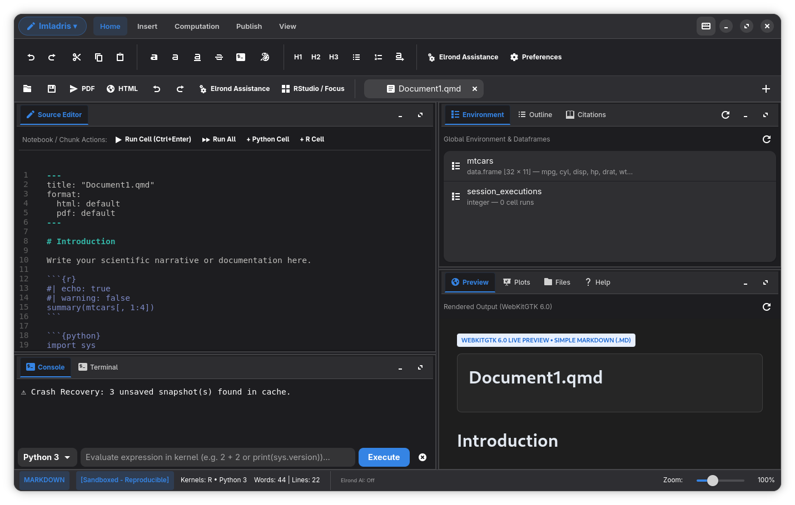
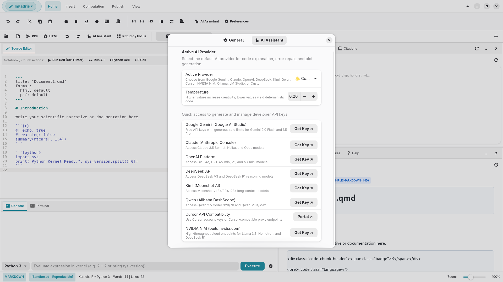
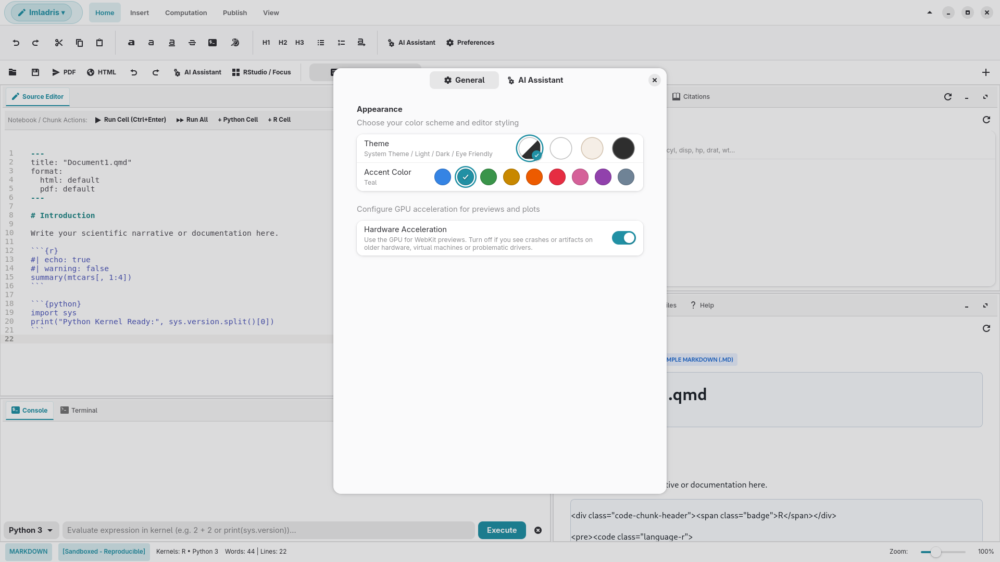
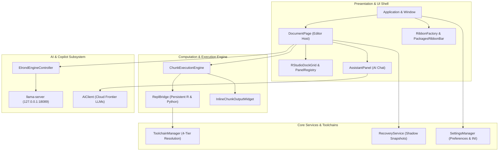

<p align="center">
  
</p>

<h1 align="center">Imladris</h1>
<h3 align="center">A GNOME-native home for scientific writing, notebooks and data work</h3>

<p align="center">
  <a href="https://github.com/Antux912012/imladris-next-md-editor/releases"></a>
  
  
  
</p>

<p align="center">
  
</p>

Imladris is a desktop editor for people who write with code in it: Quarto and R Markdown reports, Jupyter notebooks, R and Python scripts, and plain Markdown or HTML when that's all you need. It's written in **Vala** on **GTK4 + Libadwaita**, and it tries hard to feel like it belongs on a GNOME desktop.

The itch it scratches is simple. RStudio is great for analysis but heavy for prose; Apostrophe is lovely for prose but can't run a chunk. Imladris switches between the two depending on what you opened: a `.md` file gets a calm, quick writing view, while a `.qmd` or `.ipynb` gets a full four-quadrant workbench with editor, console, environment and files.

> Imladris is an independent project. It is not affiliated with or endorsed by Posit, RStudio or Project Jupyter.

---

## What it does

### Two modes, picked automatically
- **Writer mode** for `.md` and `.html`: no kernels are started, nothing computational is shown, and the ribbon shows only formatting, live preview and export.
- **Workbench mode** for `.Rmd`, `.qmd`, `.ipynb`, `.R` and `.py`: source editor, environment/outline pane, console + terminal, and a files/plots/packages pane.

### Modernized Libadwaita Ribbon Menu
The Ribbon menu has been modernized to integrate seamlessly with GNOME Libadwaita and GTK4 design language:
- **6 High-Density Tabs**: Consolidated into 6 high-utility tabs: `Home`, `Insert`, `Computation`, `Publish`, `View`, and **`Packages`**.
- **Context-Aware Dynamic Visibility**: The `Packages` tab is automatically visible and enabled for computational workflows (`.Rmd`, `.Qmd`, `.ipynb`, `.R`, `.py`) and hidden for plain `.md` and `.html` files.
- **Linked Controls & Design Tokens**: Uses native `@headerbar_bg_color`, `@window_bg_color`, and `@accent_color` tokens with linked button groups (`.linked`), reducing vertical height by ~35px to a sleek ~52px deck.
- **Collapsible Ribbon (`Ctrl+F1`)**: Quickly collapse or expand the ribbon deck on demand with the top-bar chevron button or `<Control>F1` shortcut for maximum editor focus.
- **Wired Functional Tools**: Built-in undo/redo (`Ctrl+Z` / `Ctrl+Shift+Z`), headings (`#`, `##`, `###`), lists and blockquotes, interactive 6x6 table picker popover, code chunk popover, citation popovers, LaTeX math (`$$`), Mermaid diagrams, ggplot2 snippets, and live zoom slider.
- **Context-Aware State Machine**: A dedicated engine (`Window.update_ribbon_state_machine`) adapts visible and sensitive states based on document format and project sandbox type, avoiding irrelevant actions.

### Running code
- Persistent **R** and **Python** sessions (`ReplBridge`) run as long-lived subprocesses, so variables survive between chunks like they do in a real REPL.
- Chunks run inline (`Ctrl+Shift+Enter`). Output and plots land in a card under the chunk, anchored in the `GtkSourceView` buffer.
- R plots are captured through a PNG device; Python figures through matplotlib's Agg backend. Multi-line Python is shipped base64-encoded to dodge quoting and indentation problems.
- The working directory is the project root everywhere: processes are spawned with `set_cwd`, and R (`setwd`), Python (`os.chdir`), the terminal and the Files pane all follow along.

### Projects: Standard vs Sandboxed
| | Standard | Sandboxed |
| :--- | :--- | :--- |
| R packages | your user library | project-local `renv` |
| Python packages | system / user site-packages | project-local `.venv` |
| Portable? | No, and the UI tells you so | Yes, via `renv.lock` + `requirements.txt` |
| Status badge | `[System Libraries - Non-Portable]` | `[Sandboxed - Reproducible]` |

Exporting a Standard project asks for confirmation first, because it may not run elsewhere. Sandboxed projects can be exported for **RStudio** (`.Rproj`, `.Rprofile`, `renv/activate.R`) or **Jupyter** (`requirements.txt`, `environment.yml`, a bootstrap script).

### The `.mallorn` format
A `.mallorn` file is RStudio's `.Rproj` DCF syntax with a few namespaced `Imladris*` keys added. Imladris keeps `<name>.mallorn` and `<name>.Rproj` in sync, so a project opens in both tools. A whole project can also be packed into a single portable archive (`.tar.zst`, with a `.zip` fallback) that leaves out heavy library folders and keeps the lockfiles.

### "Write with Elrond Assistance (AI)" — Zero-Config Local Copilot
Imladris features a built-in, zero-configuration local AI coding and data science copilot branded as **Elrond Assistance (AI)**, specialized in **R (tidyverse, ggplot2), Python (pandas, numpy, matplotlib), SQL, HTML, and Quarto/RMarkdown data analysis**:
- **Zero-Setup "Click-and-Run"**: Enable Elrond with a single switch in **Preferences → AI & Elrond**. If missing, the optimal vertical coding model (`Qwen2.5-Coder-3B`) is automatically bootstrapped in the background with live download progress.
- **Inline AI Autocompletion**: Real-time inline code completions as you type in R, Python, SQL, and Markdown powered by GtkSourceView completion providers (enabled by default, configurable in Preferences).
- **Custom GGUF Model Support & Auto-Discovery**: Choose your own custom `.gguf` file via the file picker in Preferences, or let Elrond auto-discover local models already installed by LM Studio, HuggingFace cache, Ollama, or Imladris.
- **Dual Hardware Acceleration (Vulkan & CUDA)**: Toggle seamlessly between **Vulkan GPU compute** (default, universally compatible across Intel, AMD, and NVIDIA) and dedicated **NVIDIA CUDA** backends, falling back cleanly to multi-threaded CPU execution if no dedicated GPU is detected.
- **Robust Daemon Health Handshake**: Resilient HTTP `/health` polling daemon startup with dynamic `LD_LIBRARY_PATH` loading for bundled Vulkan/CUDA libraries, avoiding stalls or silent failures.
- **3-Stop Assistance Level Slider**: An intuitive discrete slider in Preferences lets you tune the copilot interaction:
  - **Low** *(On-Demand Only)*: Activated strictly via the *"Write with Elrond Assistance"* button or `Ctrl+Shift+E` / `Ctrl+Space`. Uses a lean `--ctx-size 2048` profile.
  - **Medium** *(Smart Autocomplete)*: Debounced inline code completions with active dataframe column awareness (`mtcars`, `df.dtypes`).
  - **High** *(Full Elrond Copilot)*: Full document context awareness, proactive `ggplot2`/`matplotlib` graph suggestions, and automated statistical analysis generation.
- **Distro-Aware Engine Setup**: The application automatically inspects `/etc/os-release` to detect your host Linux distribution (Debian, Fedora, Arch, openSUSE, Solus, NixOS, Omarchy) and presents only the exact terminal command required for your OS with a one-click copy button.
- **Non-Blocking Background Auto-Installer**: If `llama-server` is not installed on `$PATH`, clicking *"Install Engine Now"* downloads and installs a standalone binary to `~/.local/share/imladris/bin/` asynchronously without locking the UI.
- **Live Status Bar Telemetry Monitor**: Positioned directly next to the word/line counter in the bottom status bar, continuously displaying live memory metrics every 2 seconds with zero main-thread I/O blocking:
  > `Elrond running on Qwen2.5-Coder-3B - 0.24 GB RAM / 2.08 GB VRAM used`
- **Editor Context Menu & Shortcut**: Right-click anywhere in the editor or press `Ctrl+Shift+E` to trigger the inline **"Write with Elrond Assistance (AI)"** generation popover.

#### ⚠️ Important Notice: Local AI Requirements (`llama.cpp`)
In order to use the built-in local AI functions (Elrond Assistance, offline statistical coding, and local telemetry), **`llama.cpp`** (`llama-server`) is required on your system.

The app automatically detects your distribution in **Preferences → AI & Elrond**, or you can install it manually:

| Distribution | Installation Command |
| :--- | :--- |
| **Debian / Ubuntu** | `sudo apt install llama.cpp` *(or `sudo apt install llama-cpp`)* |
| **Fedora** | `sudo dnf install llama-cpp` |
| **openSUSE** (Tumbleweed / Leap) | `sudo zypper install llama-cpp` |
| **Arch Linux** | `sudo pacman -S llama.cpp` *(or `yay -S llama.cpp`)* |
| **Solus** | `sudo eopkg install llama.cpp` |
| **NixOS** | `nix-env -iA nixpkgs.llama-cpp` *(or add `pkgs.llama-cpp` to `environment.systemPackages`)* |
| **Omarchy** | `omarchy pkg add llama.cpp` *(or `yay -S llama.cpp` / `Super + Space` → Install → Package)* |
| **Universal / One-Line** | `curl -LsSf https://llama.app/install.sh \| sh` |
| **Flatpak Bundle** | *Pre-bundled out of the box in `/app/bin/llama-server`.* |
| **In-App Auto-Installer** | If not found on `$PATH`, click **"Install Engine Now"** in Preferences to automatically download a standalone prebuilt `llama-server` binary into `~/.local/share/imladris/bin/`. |

### Packages Ribbon Tab
An always-accessible top window menu tab (`Ctrl+Shift+P` or clicking **Packages** in the top ribbon menu) replacing modal dialogs with an integrated dual-group toolbar:
- **R Packages Section (Left)**: Official R logo badge, CRAN package search with live popover autocomplete, one-click install button, and a `...` menu for GitHub repositories (`remotes::install_github` / `pak::pkg_install`) and local source archives (`.tar.gz`, `.zip`).
- **Python Packages Section (Right)**: Official Python logo badge, PyPI search with live popover autocomplete, and a `...` menu for GitHub repositories (`git+https://`) and local wheels/archives (`.whl`, `.tar.gz`).
- **Target Pill & Dependencies**: Dynamic environment indicator pill (`[Target: Sandboxed (renv / .venv)]` in green vs `[Target: System Library]` in amber) and a *"With dependencies"* toggle.
- **ETag Disk Caching & $O(\log N)$ Binary Search**: Cached sorted package registries in `~/.cache/imladris/indices/` with HTTP ETag validation and instant binary search prefix lookup (under 0.1ms).
- **`pak` & `uv` Fast-Path Acceleration**: Leverages `pak::pkg_install` for R and `uv pip install` for Python when available, cutting installation times by up to 10x.
- **Automatic Lockfile Synchronization**: Automatically updates `renv.lock` or `requirements.txt` upon successful installation in sandboxed projects.

### Automated `micromamba` Toolchain & 4-Tier Runtime Resolution
Imladris v0.9.0 introduces a built-in automated Data Science Toolchain Manager powered by **`micromamba`** (a single, statically-linked ~18MB C++ executable with zero host dependencies):

#### Why It Matters: Zero Root & Zero Host Setup
On Linux and inside Flatpak containers, running scientific code typically requires host interpreters or compiling packages like `tidyverse` from C/C++/Fortran source, which frequently fails due to missing headers (`libcurl-devel`, `openssl-devel`, `libxml2-devel`). Imladris eliminates this entirely:
- **One-Click Provisioning**: Installs **R 4.4**, **Python 3.12**, and **Quarto CLI + Typst** into Imladris's user data directory (`$XDG_DATA_HOME/imladris/toolchains/`) with zero root permissions.
- **Pre-Compiled Binary Packages**: Fast installations of `r-tidyverse`, `r-data.table`, and hundreds of packages with bundled shared libraries.
- **Built-in Compiler Toolchain**: Bundles `compilers`, `make`, `pkg-config`, and dev headers inside the prefix. Standard `install.packages(...)` calls in R cells compile cleanly out of the box without host GCC headaches.
- **Automated `Rprofile.site` Optimization**: Injects cloud CRAN mirror (`https://cloud.r-project.org`) and multi-core compilation (`options(Ncpus = detectCores() - 1)`) so source builds execute in parallel automatically.
- **Instant Project Sandboxes**: Creating a sandboxed project (`.imladris-env`) reuses packages from the shared cache (`mamba_root/pkgs`) via hardlinks, initializing full R/Python environments in under 3 seconds with near-zero extra disk usage.

#### 4-Tier Runtime Resolution Hierarchy
Whenever a chunk, script, or export pipeline runs, Imladris resolves the executable in strict priority order:
1. **Tier 1: Project-Local Sandbox**: Checks `<project_root>/.imladris-env/bin/` (or `.venv`). Injects managed environment variables (`PATH`, `CONDA_PREFIX`, `PKG_CONFIG_PATH`, `R_HOME`, `QUARTO_PYTHON`, `QUARTO_R`).
2. **Tier 2: Managed Global Toolchain**: Checks `$XDG_DATA_HOME/imladris/toolchains/mamba_root/envs/base-ds/bin/` and runs with injected managed environment variables.
3. **Tier 3: Host Fallback (Flatpak-Aware)**: Checks host system via `flatpak-spawn --host` (if running inside Flatpak) or native `$PATH`. Temporary scripts and graphics plots are automatically routed through the shared cache directory (`~/.cache/imladris/tmp/`).
4. **Tier 4: Missing Runtime**: Instead of failing with an unrecoverable error, renders an actionable prompt that opens the **One-Click Toolchain Setup Dialog**.

#### How to Access the Toolchain Manager
- **Actionable Callout**: If code is executed without an available interpreter, Imladris automatically offers to install R, Python, and Quarto.
- **Computation Ribbon**: Click the **Toolchains** button in the Computation tab.
- **Brand Menu**: Select **Imladris ▾ → Data Science Toolchains...** from the top bar.

### Export
Documents go to HTML, PDF, **ODT** and **ODP**. Imladris uses Quarto, rmarkdown or Pandoc when they're installed, goes through LibreOffice for slides, and falls back to a built-in OpenDocument writer when none of that is available.

### The creation dialog
One dialog, nine plain-labelled choices: *Create a Project*, *Create a Sandboxed project*, *Create a simple .md*, *Create a simple .html*, *Create a R script file*, *Create a .Rmd*, *Create a .Qmd*, *Create a .ipynb*, *Create a Python script*.

### AI Assistant & Writing Co-Author
Imladris includes a dedicated AI writing and coding panel with out-of-the-box support for the leading scientific and coding models:
- **Google Gemini**: First-class support via **Google AI Studio** free API keys or **Google Account OAuth** tokens (`gemini-2.0-flash`, `gemini-1.5-flash`, `gemini-1.5-pro`, `gemini-2.0-flash-thinking-exp`).
- **Claude (Anthropic API)**: Native `/v1/messages` protocol support with reasoning/thinking block extraction (`claude-3-5-sonnet-20241022`, `claude-3-5-haiku-20241022`, `claude-3-opus-20240229`).
- **OpenAI API**: Official OpenAI endpoints for `gpt-4o`, `gpt-4o-mini`, `o1`, and `o3-mini`.
- **DeepSeek API**: Access `deepseek-chat` and `deepseek-reasoner` (DeepSeek-R1) with native extraction and display of the reasoning/thought chain.
- **Kimi API (Moonshot AI)**: `moonshot-v1-8k`, `moonshot-v1-32k`, and `kimi-latest` for ultra-long context documents.
- **Qwen API (Alibaba Cloud DashScope)**: Direct integration with `qwen2.5-coder-32b-instruct` and `qwen-plus`.
- **Cursor API Compatibility**: Connect seamlessly with Cursor accounts or Cursor-compatible endpoints (`cursor-small`, `claude-3-5-sonnet`, `gpt-4o`).
- **NVIDIA NIM**: High-performance inference endpoints at `integrate.api.nvidia.com` for models like `meta/llama-3.3-70b-instruct`, `deepseek-ai/deepseek-r1`, and `nvidia/llama-3.1-nemotron-70b-instruct`.
- **Local Ollama & LM Studio**: Zero-cloud offline privacy via Ollama (`localhost:11434`) or LM Studio Local Server (`localhost:1234`).
- **Custom OpenAI-Compatible**: Connect to any endpoint (Groq, Mistral, Together, vLLM, private proxies).

<p align="center">
  
</p>

Credentials and model choices are persisted locally in `~/.config/imladris/ai_config.json` (restricted to user read-write mode `0600`) and automatically detect standard environment variables (`GEMINI_API_KEY`, `ANTHROPIC_API_KEY`, `OPENAI_API_KEY`, `DEEPSEEK_API_KEY`, `MOONSHOT_API_KEY`, `DASHSCOPE_API_KEY`, `CURSOR_API_KEY`, `NVIDIA_API_KEY`).

### Extras
- **Appearance & GNOME Accents** (menu → Preferences, `Ctrl+,`): switch between System Theme, Light, Dark, and Eye Friendly (warm sepia) palettes. Includes GNOME Settings-style circular accent color swatches (Blue, Teal, Green, Yellow, Orange, Red, Pink, Purple, Slate) with live synchronization to `org.gnome.desktop.interface accent-color`.
- **Hardware acceleration toggle** (menu → Preferences, `Ctrl+,`): switches every WebKit view between GPU compositing and pure software rendering, live, with the choice stored in GSettings. Handy on VMs, older hardware or flaky drivers.

<p align="center">
  
</p>

Built-in MCP server (`imladris --mcp-server`), and crash recovery that keeps shadow copies of unsaved work in `~/.cache/imladris/recovery/`. The AI assistant is off the critical path: nothing is sent anywhere unless you configure an endpoint and use it.

---

## Architecture & Subsystem Map

Imladris is structured around a decoupled, reactive architecture separating presentation, interactive execution, AI services, and persistent runtime management:



| Subsystem | Primary Components | Key Source Files |
| :--- | :--- | :--- |
| **Presentation & UI Shell** | Ribbon Bar, Dock Grid, Tabs, Settings | `Application.vala`, `Window.vala`, `DocumentPage.vala`, `PackagesRibbonBar.vala`, `PreferencesDialog.vala` |
| **Computation & REPL** | Interactive Stdio, Cell Execution, Devices | `ReplBridge.vala`, `ChunkExecutionEngine.vala`, `ChunkParser.vala`, `InlineChunkOutputWidget.vala` |
| **AI & Copilot Services** | Local `llama.cpp` Supervisor, Cloud APIs | `ElrondEngineController.vala`, `AiCompletionProvider.vala`, `AiClient.vala`, `AssistantPanel.vala` |
| **Core & Toolchains** | 4-Tier Resolution, Sandboxes, Recovery | `ToolchainManager.vala`, `SettingsManager.vala`, `MallornManager.vala`, `RecoveryService.vala` |

For complete technical specifications, component connection maps, sequence flows, and the **Bug Localization & Diagnostic Matrix**, consult the **[Architecture Blueprint (docs/ARCHITECTURE.md)](docs/ARCHITECTURE.md)**.

---

## Install

Packages for each release live on the [Releases page](https://github.com/Antux912012/imladris-next-md-editor/releases).

**Flatpak**
```bash
flatpak install --user io.github.Antux912012.Imladris.flatpak
flatpak run io.github.Antux912012.Imladris
```
The Flatpak requests network access (package downloads and optional AI endpoints), home-folder access (your projects), and the `org.freedesktop.Flatpak` portal. The Flatpak supports both transparent host toolchain discovery (`flatpak-spawn --host`) AND fully self-contained zero-root execution via the built-in automated `micromamba` toolchain manager.

**Arch Linux (AUR)**
```bash
# Using yay
yay -S imladris

# Or using paru
paru -S imladris
```
PKGBUILD and `.SRCINFO` are located in the `packaging/` directory.

**Fedora**
```bash
sudo dnf install ./imladris-0.12.0-1.fc44.x86_64.rpm
```

**Debian / Ubuntu**
```bash
sudo dpkg -i imladris_0.12.0_amd64.deb && sudo apt-get install -f
```

## Build from source

Needs `valac` ≥ 0.56, `meson`, `ninja`, GTK4 ≥ 4.12, libadwaita ≥ 1.5, GtkSourceView 5, WebKitGTK 6.0, libsoup 3, json-glib, libgee and GLib ≥ 2.76.

```bash
meson setup build
meson compile -C build
meson test -C build --print-errorlogs
./build/imladris
```

Packaging helpers: `./build-rpm.sh` (Fedora) and `./build-packages.sh` (`.deb` + Flatpak bundle).

## MCP server

```bash
imladris --mcp-server
```
```json
{ "mcpServers": { "imladris": { "command": "imladris", "args": ["--mcp-server"] } } }
```

## Shortcuts

| Shortcut | Action |
| :--- | :--- |
| `Ctrl+N` | New project / document dialog |
| `Ctrl+O` / `Ctrl+S` | Open / Save |
| `Ctrl+F1` | Toggle Ribbon collapse / expand |
| `Ctrl+Z` / `Ctrl+Shift+Z` | Undo / Redo |
| `Ctrl++` / `Ctrl+-` / `Ctrl+0` | Zoom In / Zoom Out / Reset Zoom (100%) |
| `Ctrl+Shift+E` | Write with Elrond Assistance (AI) |
| `Ctrl+Shift+P` | Packages Ribbon tab / Search packages |
| `Ctrl+Enter` | Run line or selection |
| `Ctrl+Shift+Enter` | Run current chunk |
| `Ctrl+,` | Preferences (Appearance & AI Providers) |
| `Ctrl+Q` | Quit |

---

## AI disclosure (code provenance)

In the spirit of transparency, and to meet Flathub's expectations around AI-generated contributions:

- **A large share of this codebase was written with AI coding assistants** (large language models used as pair-programming agents), including much of the Vala source, build scripts, packaging files, tests and this documentation.
- **The maintainer directs the work and is accountable for it.** Design decisions, feature scope and releases are the maintainer's; AI output is treated as a draft, not as authority.
- **Verification is mechanical, and you should know its limits.** Changes are built and run through the Meson test suite (11 test cases covering data models, `.mallorn` round-trips, sandboxes, exports, sessions, the chunk parser and the REPL bridge), plus `appstreamcli` and `desktop-file-validate`. Passing tests is not the same as a line-by-line human audit, and some areas, especially UI behaviour, have had less scrutiny than others.
- **Licensing.** All code is distributed under GPL-3.0-or-later. If you spot code that looks copied from another project, please open an issue so it can be checked and fixed or attributed.
- **Runtime AI is opt-in.** The optional assistant and MCP server only talk to endpoints *you* configure. No telemetry is collected.
- **Bug reports and human review are very welcome**, particularly for security-relevant paths: subprocess spawning, archive extraction and file export.

## Privacy & GDPR Compliance

Imladris is built from the ground up to respect user privacy and adhere to the European Union General Data Protection Regulation (GDPR):
- **Zero Remote Telemetry**: Imladris collects no analytics, tracking data, crash dumps, or usage metrics. Status bar telemetry is strictly local CPU/RAM/VRAM hardware polling.
- **Local-First AI**: Elrond Assistance runs 100% locally via `llama-server` (`127.0.0.1:8088`). No prompts, narrative context, or code ever leave your machine.
- **Direct Encrypted Cloud AI**: Third-party frontier AI models (Gemini, Claude, OpenAI) are strictly opt-in and connect directly to official provider APIs using your own API keys.
- For complete details, see our [Privacy Policy (PRIVACY.md)](PRIVACY.md).

## Contributing

Issues and pull requests are welcome. If you used an AI tool for a contribution, just say so in the PR description; nobody's judging, it just helps reviewers know where to look harder.

## License

All core Imladris code is distributed under **[GNU General Public License v3.0 or later (GPL-3.0-or-later)](LICENSE)**. Permissive (MIT) code is fully compatible with and subsumed under GPLv3. Bundled Papirus symbolic icons are distributed under GNU GPLv3.
