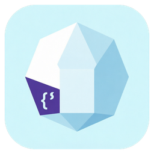

<p align="center">
  
</p>

<h1 align="center">Imladris</h1>
<h3 align="center">Polyglot Scientific & Web Studio with AI & MCP</h3>

<p align="center">
  <a href="https://github.com/Antux912012/imladris-next-md-editor/releases"></a>
  <a href="https://gitlab.gnome.org/GNOME/libadwaita"></a>
  <a href="https://github.com/Antux912012/imladris-next-md-editor/releases/tag/v0.5.0"></a>
  <a href="https://github.com/Antux912012/imladris-next-md-editor/releases/tag/v0.5.0"></a>
</p>

<p align="center">
  
</p>

**Imladris** is a native Linux polyglot document studio and Markdown editor built with **Vala**, **GTK4**, **Libadwaita**, **GtkSourceView 5**, and **WebKitGTK 6.0**. It features **Dual-Mode AI Assistance** (Online OpenAI-compatible + Offline `llama.cpp` with Qwen 2.5 Coder), an embedded **Model Context Protocol (MCP)** server, and smart language auto-completion.

---

## 🚀 Supported Formats

| Format | Extension | Capabilities |
| :--- | :--- | :--- |
| **Quarto** | `.qmd` | YAML frontmatter, executable `{r}`, `{python}`, `{ts}` code chunks, PDF/HTML render pipeline |
| **R Markdown** | `.Rmd` | Knitr syntax, inline code execution via `Rscript`, live HTML preview |
| **Jupyter Notebooks** | `.ipynb` | JSON structure awareness, chunk controls, kernel execution |
| **TypeScript / OJS** | `.ts` | Syntax highlighting, TypeScript compiler (`tsc`) integration, esbuild bundling |
| **HTML5** | `.html` | Full HTML5 boilerplate generation, live interactive WebKit preview |
| **Markdown** | `.md` | Rich text formatting, LaTeX math (`$$`), Mermaid diagrams, footnotes, citations |

---

## ✨ Features

- **🤖 Dual-Engine AI Assistance:**
  - **Online:** Connects to any OpenAI-compatible endpoint (OpenAI, DeepSeek, OpenRouter, Groq, vLLM) with customizable Base URL, API key, and model choice.
  - **Offline (`llama.cpp` / Ollama):** Runs locally via `llama-server` sidecar or Ollama. Includes built-in one-click downloader for optimized **Qwen 2.5 Coder** models (`1.5B` and `7B` GGUF).
  - **Interactive Assistant Panel:** Integrated side panel with conversation history, quick action pills (*Explain*, *Fix Syntax*, *Add R Plot*), and one-click *Insert at Cursor*.
- **⚡ Smart Language Auto-Completion:**
  - GtkSourceView 5 completion subsystem with `GtkSource.CompletionWords` and `GtkSource.CompletionSnippets`.
  - Automatic suggestions and code completions across `.md`, `.html`, `.Rmd`, `.ipynb`, `.ts`, and Python.
- **🔌 Embedded Model Context Protocol (MCP) Server:**
  - Standard JSON-RPC MCP server (`imladris --mcp-server`) exposing editor tools:
    - `get_active_document`: Inspect buffer, line count, and language.
    - `insert_text`: Programmatically insert text at cursor.
    - `insert_code_chunk`: Insert `{r}`, `{python}`, or `{ts}` chunks with options.
    - `execute_code`: Asynchronously execute CLI scripts.
    - `render_document`: Trigger Quarto HTML/PDF render pipeline.
    - `get_open_tabs`: Inspect all open tabs in the workspace.
- **🎭 Dynamic Context-Aware UI Morphing:**
  - **Apostrophe Mode (Markdown `.md`):** Distraction-free writing canvas with generous reading margins, hiding secondary docks.
  - **RStudio Workbench Mode (`.qmd`, `.rmd`, `.ipynb`):** Full 4-quadrant docking layout (Source Editor, Interactive Console, Environment & Outline, Live Preview/Plots).
  - **Smart Top Ribbon Popovers:** Interactive Table Builder ($M \times N$ grid), Multi-Language Code Chunk Inserter, Citations & Bibliography Manager, Special Symbols Picker, and Emoji Palette.
- **🛡️ Atomic Crash Recovery & Shadow Buffers:** Non-blocking background snapshots persist unsaved edits, cursor positions, and state to `~/.cache/imladris/recovery/`. Restores seamlessly upon unexpected termination.
- **🪟 Multi-Mode Split View Engine:** Flexible instant toggling between Editor Only, Preview Only, Vertical Split (Side-by-Side), and Horizontal Split (Top-and-Bottom).
- **🌐 Embedded WebKitGTK 6.0 Live Preview:** Real-time HTML5, CSS, and Reveal.js rendering directly inside an expandable right-hand split pane.
- **⚡ Asynchronous Execution Engine:** Non-blocking background execution of `quarto`, `Rscript`, `python3`, `tsc`, and `deno` via `GLib.Subprocess`.
- **🎛 Dynamic 9-Tab Ribbon Deck:** Modern Libadwaita ribbon categorized into *Home*, *Insert*, *Computation*, *Web & Publish*, *Page Layout*, *References*, *Review*, *View*, and *Section*.
- **🎨 Native GNOME HIG & Libadwaita:** Adaptive toolbar view, multi-tab document tabs (`Adw.TabView`), and dark titlebar styling.

---

## 📦 Installation & Downloads

Official releases are distributed exclusively as **Debian packages (`.deb`)** and **Flatpak bundles (`.flatpak`)**. AppImage builds are intentionally excluded.

### Option 1: Debian / Ubuntu / Pop!_OS (`.deb`)
Download the latest `.deb` package from the [v0.5.0 Release](https://github.com/Antux912012/imladris-next-md-editor/releases/tag/v0.5.0):

```bash
# Download and install
wget https://github.com/Antux912012/imladris-next-md-editor/releases/download/v0.5.0/imladris_0.5.0_amd64.deb
sudo dpkg -i imladris_0.5.0_amd64.deb

# Fix missing dependencies if needed
sudo apt-get install -f
```

### Option 2: Flatpak (Any Linux distribution)
Download the standalone single-file bundle:

```bash
wget https://github.com/Antux912012/imladris-next-md-editor/releases/download/v0.5.0/Imladris.flatpak
flatpak install --user Imladris.flatpak
flatpak run org.gnome.Imladris
```

---

## 🔌 Running as an MCP Server

Imladris can run headlessly as an MCP server over stdio for external AI agents (e.g. Claude Desktop, Antigravity):

```bash
imladris --mcp-server
```

Example configuration for Claude Desktop (`claude_desktop_config.json`):
```json
{
  "mcpServers": {
    "imladris": {
      "command": "imladris",
      "args": ["--mcp-server"]
    }
  }
}
```

---

## 🛠 Building From Source

### Dependencies
- `valac` (>= 0.56)
- `meson` (>= 0.60)
- `ninja`
- `gtk4` (>= 4.12)
- `libadwaita-1` (>= 1.5)
- `gtksourceview-5` (>= 5.10)
- `webkitgtk-6.0` (>= 2.40)
- `libsoup-3.0` (>= 3.0)
- `json-glib-1.0` (>= 1.0)
- `glib-2.0` (>= 2.76)

### Building via GNOME SDK (Recommended)
```bash
flatpak run --filesystem=host --command=bash org.gnome.Sdk//50 -c \
  "meson setup builddir && ninja -C builddir && ./builddir/imladris"
```

### Generating `.deb` and Flatpak Packages
Use the automated package builder:
```bash
./build-packages.sh
```

---

## ⌨ Keyboard Shortcuts

| Shortcut | Action |
| :--- | :--- |
| `Ctrl+N` | New Quarto Document (`.qmd`) |
| `Ctrl+O` | Open File |
| `Ctrl+S` | Save Document |
| `Ctrl+Q` | Quit Imladris |

---

## 📄 License
This project is licensed under the **GNU General Public License v3.0 or later** (GPL-3.0-or-later).
