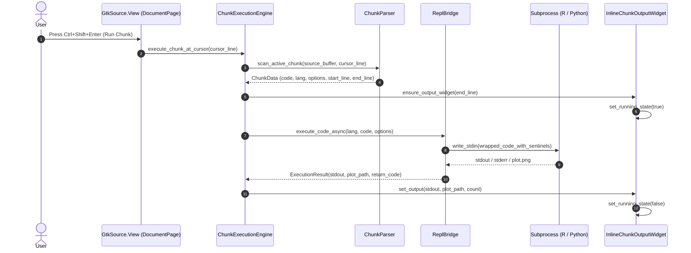
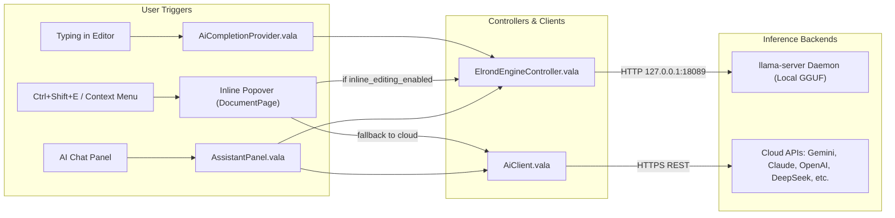
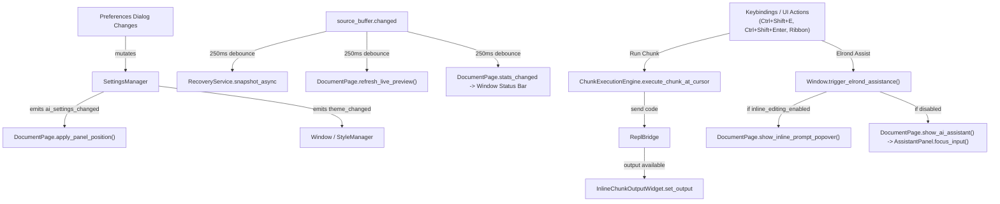

# Imladris: Architectural Blueprint & Component Connection Map

> **Purpose:** This document provides a complete structural map of Imladris, detailing the connections between all UI, computational, AI, and system layers. Use this guide to understand data flows, identify component responsibilities, and pinpoint the exact source file when debugging issues.

---

## 1. High-Level System Architecture

Imladris is built in **Vala** on **GTK4 + Libadwaita**, with **GtkSourceView 5** for text editing, **WebKitGTK 6.0** for rendering, and **libsoup-3.0** for networking.

```mermaid
flowchart TD
    subgraph UI_Layer ["🖥️ Presentation & UI Shell"]
        APP["Application.vala<br/>(Gtk.Application, Action Map)"]
        WIN["Window.vala<br/>(Adw.ApplicationWindow, Ribbon, Tabs)"]
        RIBBON["RibbonFactory.vala & SmartRibbonHelpers.vala<br/>(Dynamic Ribbon Toolbars & Popovers)"]
        PKG_UI["PackagesRibbonBar.vala<br/>(CRAN & PyPI Integrated Ribbon)"]
        DOC["DocumentPage.vala<br/>(Editor, Split Paned, Dock Host)"]
        DOCK["RStudioDockGrid.vala & PersistentPanelRegistry.vala<br/>(4-Quadrant Workbench Layout)"]
        CHAT["AssistantPanel.vala<br/>(Interactive AI Chat & Model Selector)"]
        PREFS["PreferencesDialog.vala & AiSettingsDialog.vala<br/>(Appearance, Elrond AI, Cloud API Keys)"]
    end

    subgraph Editor_Execution ["⚙️ Editor & Execution Subsystem"]
        VIEW["GtkSource.View / Buffer<br/>(Syntax Highlighting, TextTags)"]
        COMPLETION["AiCompletionProvider.vala<br/>(Inline AI Copilot Suggestions)"]
        PARSER["ChunkParser.vala<br/>(Code Cell & Option Boundary Scanner)"]
        CHUNK_ENG["ChunkExecutionEngine.vala<br/>(Cell Pipeline & Output Dispatcher)"]
        OUT_WIDGET["InlineChunkOutputWidget.vala<br/>(Embedded Cards, Stdout, Plots)"]
        REPL["ReplBridge.vala<br/>(Persistent Interactive R & Python Stdio)"]
        SESS_MGR["PersistentSessionManager.vala<br/>(Project REPL Lifecycle & PWD Sync)"]
    end

    subgraph AI_Subsystem ["🧠 AI & Elrond Copilot Subsystem"]
        ELROND["ElrondEngineController.vala<br/>(Smart Local AI & Agent Harness Bridge)"]
        LOCAL_SERVERS["Local Inference & Agent Harnesses<br/>(Ollama :11434, LM Studio :1234, Cherry :23333, Antigravity agy)"]
        AI_CLIENT["AiClient.vala<br/>(Cloud REST Client: Gemini, Claude, OpenAI, etc.)"]
        AI_CFG["AiConfigManager.vala<br/>(API Keys, Models, Endpoints Config)"]
        MCP["McpServer.vala<br/>(Model Context Protocol Stdio Server)"]
    end

    subgraph Core_Services ["📦 Core Services & Domain Models"]
        SETTINGS["SettingsManager.vala<br/>(GSettings + settings.ini)"]
        TOOLCHAIN["ToolchainManager.vala<br/>(4-Tier Runtime Resolution Hierarchy)"]
        MALLORN["MallornManager.vala<br/>(.mallorn / .Rproj Scaffold & Packaging)"]
        RECOVERY["RecoveryService.vala<br/>(Shadow Snapshot Auto-Recovery)"]
        EXPORT["ExportService.vala<br/>(Quarto, Pandoc, Typst, ODT/ODP Pipeline)"]
        PKG_CACHE["PackageIndexCache.vala<br/>(CRAN & PyPI ETag Binary-Search Cache)"]
        PLATFORM["PlatformUtils.vala<br/>(Distro Detection, Flatpak Host Spawning)"]
    end

    %% Connections
    APP --> WIN
    WIN --> DOC
    WIN --> RIBBON
    WIN --> PKG_UI
    WIN --> PREFS
    DOC --> VIEW
    DOC --> DOCK
    DOC --> CHAT
    DOC --> RECOVERY
    VIEW --> COMPLETION
    VIEW --> PARSER
    DOC --> CHUNK_ENG
    CHUNK_ENG --> PARSER
    CHUNK_ENG --> REPL
    CHUNK_ENG --> OUT_WIDGET
    REPL --> SESS_MGR
    REPL --> TOOLCHAIN
    COMPLETION --> ELROND
    CHAT --> AI_CLIENT
    CHAT --> ELROND
    CHAT --> AI_CFG
    ELROND --> LLAMA
    ELROND --> PLATFORM
    TOOLCHAIN --> PLATFORM
    DOC --> SETTINGS
    PREFS --> SETTINGS
    PREFS --> ELROND
    PKG_UI --> PKG_CACHE
```



---

## 2. Component Inventory & Responsibility Map

### 2.1 UI & Presentation Layer (`src/`, `src/ui/`)

| Component | File Path | Responsibilities & Connections |
| :--- | :--- | :--- |
| **`Application`** | [`src/Application.vala`](file:///home/antonio/Projects/imladris-next-md-editor/src/Application.vala) | Root GTK application singleton. Registers application actions (`app.*`), global accelerators (`Ctrl+Shift+E`, `Ctrl+F1`), and bundled Papirus SVG icon resources. |
| **`Window`** | [`src/Window.vala`](file:///home/antonio/Projects/imladris-next-md-editor/src/Window.vala) | Main application shell (`Adw.ApplicationWindow`). Coordinates the multi-tier Libadwaita ribbon bar, document tabs (`Adw.TabView`), project status badge, and routing for Elrond AI assistance. |
| **`RibbonFactory`** | [`src/RibbonFactory.vala`](file:///home/antonio/Projects/imladris-next-md-editor/src/RibbonFactory.vala) | Declarative factory producing linked tool button groups, collapsible sections, and menu buttons according to Libadwaita design tokens. |
| **`SmartRibbonHelpers`** | [`src/SmartRibbonHelpers.vala`](file:///home/antonio/Projects/imladris-next-md-editor/src/SmartRibbonHelpers.vala) | Generates interactive popovers for code chunk insertion (`{r}`, `{python}`, `{sql}`), citation keys, LaTeX formulas, and 6x6 table creation grids. |
| **`PackagesRibbonBar`** | [`src/ui/PackagesRibbonBar.vala`](file:///home/antonio/Projects/imladris-next-md-editor/src/ui/PackagesRibbonBar.vala) | Dual-pane CRAN and PyPI package installer bar. Connects to `PackageIndexCache` for real-time autocompletion and calls `pak` or `uv` via `ToolchainManager`. |
| **`DocumentPage`** | [`src/DocumentPage.vala`](file:///home/antonio/Projects/imladris-next-md-editor/src/DocumentPage.vala) | Active document container. Manages single-pane writer view vs 4-quadrant RStudio workbench, dynamic left/right AI chat and preview docking, and debounced shadow buffer backups. |
| **`PersistentPanelRegistry`** | [`src/ui/PersistentPanelRegistry.vala`](file:///home/antonio/Projects/imladris-next-md-editor/src/ui/PersistentPanelRegistry.vala) | Caches singleton widgets (Console, Terminal, WebKit Preview, Environment, Files, Plots) to prevent expensive re-instantiation across tab switches. |
| **`RStudioDockGrid`** | [`src/ui/RStudioDockGrid.vala`](file:///home/antonio/Projects/imladris-next-md-editor/src/ui/RStudioDockGrid.vala) | Implements the four-quadrant split layout (Editor, Console, Environment/Outline, Preview/Files/Plots) with draggable paned dividers. |
| **`AssistantPanel`** | [`src/AssistantPanel.vala`](file:///home/antonio/Projects/imladris-next-md-editor/src/AssistantPanel.vala) | Interactive AI chat panel. Features model dropdown with official brand SVG logos, quick action buttons (Explain, Fix, Add Plot, Insert at Cursor), and streaming output view. |
| **`PreferencesDialog`** | [`src/ui/PreferencesDialog.vala`](file:///home/antonio/Projects/imladris-next-md-editor/src/ui/PreferencesDialog.vala) | Preferences editor for themes, GNOME accent colors, Elrond local model setup, inline editing toggles, and side panel left/right positioning. |
| **`AiSettingsDialog`** | [`src/ui/AiSettingsDialog.vala`](file:///home/antonio/Projects/imladris-next-md-editor/src/ui/AiSettingsDialog.vala) | Multi-provider API credential manager for Google Gemini, Claude, OpenAI, DeepSeek, Kimi, Qwen, Cursor, NVIDIA NIM, Ollama, LM Studio, and Custom endpoints. |
| **`InlineChunkOutputWidget`** | [`src/ui/InlineChunkOutputWidget.vala`](file:///home/antonio/Projects/imladris-next-md-editor/src/ui/InlineChunkOutputWidget.vala) | Card widget anchored beneath code chunks in the GtkSourceView editor displaying stdout text, stderr diagnostics, and rendered PNG plots. |

---

### 2.2 Computation & Execution Subsystem (`src/console/`, `src/editor/`, `src/services/`)



| Component | File Path | Responsibilities & Connections |
| :--- | :--- | :--- |
| **`ReplBridge`** | [`src/console/ReplBridge.vala`](file:///home/antonio/Projects/imladris-next-md-editor/src/console/ReplBridge.vala) | Manages long-running interactive REPL subprocesses (`R --interactive`, `python -i -u`). Injects prompt sentinels, captures graphics devices (PNG), and sets working directories. |
| **`ChunkExecutionEngine`** | [`src/editor/ChunkExecutionEngine.vala`](file:///home/antonio/Projects/imladris-next-md-editor/src/editor/ChunkExecutionEngine.vala) | Dispatches chunk execution, parses options (`#| echo: false`), routes code to `ReplBridge`, and mounts `InlineChunkOutputWidget`. |
| **`ChunkParser`** | [`src/core/ChunkParser.vala`](file:///home/antonio/Projects/imladris-next-md-editor/src/core/ChunkParser.vala) | Zero-copy scanner for fenced markdown code chunks (````{r}`, ````{python}`, ````{sql}`) and Quarto chunk headers. |
| **`PersistentSessionManager`** | [`src/services/PersistentSessionManager.vala`](file:///home/antonio/Projects/imladris-next-md-editor/src/services/PersistentSessionManager.vala) | Project-scoped singleton ensuring variables, loaded libraries, and dataframes survive across multiple chunk runs. |
| **`SandboxController`** | [`src/services/SandboxController.vala`](file:///home/antonio/Projects/imladris-next-md-editor/src/services/SandboxController.vala) | Interacts with project virtual environments (`.venv`, `renv`, `.imladris-env`) and checks lockfiles. |

---

### 2.3 AI & Copilot Subsystem (`src/ai/`, `src/`)



| Component | File Path | Responsibilities & Connections |
| :--- | :--- | :--- |
| **`ElrondEngineController`** | [`src/ai/ElrondEngineController.vala`](file:///home/antonio/Projects/imladris-next-md-editor/src/ai/ElrondEngineController.vala) | Smart Local AI Server & Agent Harness Bridge. Probes and connects to running local inference servers (Ollama on `:11434`, LM Studio on `:1234`, Cherry Studio / LocalAI on `:23333` / `:8080`) and host agent harnesses (Antigravity `agy`, OpenCode, Pi). Completely eliminates container exit 127 crashes. |
| **`AiCompletionProvider`** | [`src/ai/AiCompletionProvider.vala`](file:///home/antonio/Projects/imladris-next-md-editor/src/ai/AiCompletionProvider.vala) | Implements `GtkSource.CompletionProvider` for real-time inline copilot completions. Debounced according to `AiAssistanceLevel`. |
| **`AiClient`** | [`src/AiClient.vala`](file:///home/antonio/Projects/imladris-next-md-editor/src/AiClient.vala) | Asynchronous HTTP client using `libsoup-3.0` supporting OpenAI-compatible endpoints and Anthropic native `/v1/messages`. |
| **`AiConfigManager`** | [`src/core/AiConfigManager.vala`](file:///home/antonio/Projects/imladris-next-md-editor/src/core/AiConfigManager.vala) | Manages provider metadata, API keys, models, and endpoints. Stores credentials in `~/.config/imladris/ai_config.json` with secure permissions (`0600`). |
| **`McpServer`** | [`src/McpServer.vala`](file:///home/antonio/Projects/imladris-next-md-editor/src/McpServer.vala) | Model Context Protocol stdio server exposing document reading and editing tools to external agents (`imladris --mcp-server`). |

---

### 2.4 Core Services & System Runtime Layer (`src/core/`, `src/services/`, `src/adapters/`)

| Component | File Path | Responsibilities & Connections |
| :--- | :--- | :--- |
| **`SettingsManager`** | [`src/core/SettingsManager.vala`](file:///home/antonio/Projects/imladris-next-md-editor/src/core/SettingsManager.vala) | Persistent application settings. Integrates GSettings schema and `~/.config/imladris/settings.ini` for Elrond AI preferences, inline editing toggle, and side panel position. |
| **`ToolchainManager`** | [`src/core/ToolchainManager.vala`](file:///home/antonio/Projects/imladris-next-md-editor/src/core/ToolchainManager.vala) | Resolves R, Python, Quarto, and Typst runtimes via a 4-tier priority hierarchy (`.imladris-env` -> micromamba -> host -> installer dialog). |
| **`MallornManager`** | [`src/core/MallornManager.vala`](file:///home/antonio/Projects/imladris-next-md-editor/src/core/MallornManager.vala) | Parses `.mallorn` / `.Rproj` project configuration files and generates portable `.tar.zst` reproducible archives. |
| **`RecoveryService`** | [`src/services/RecoveryService.vala`](file:///home/antonio/Projects/imladris-next-md-editor/src/services/RecoveryService.vala) | Asynchronous shadow snapshot engine saving unsaved buffer states to `~/.cache/imladris/recovery/` every 250ms without locking the UI thread. |
| **`ExportService`** | [`src/services/ExportService.vala`](file:///home/antonio/Projects/imladris-next-md-editor/src/services/ExportService.vala) | Pipeline rendering documents to HTML, PDF, ODT, and ODP using Quarto, Pandoc, or LibreOffice. |
| **`PackageIndexCache`** | [`src/services/PackageIndexCache.vala`](file:///home/antonio/Projects/imladris-next-md-editor/src/services/PackageIndexCache.vala) | Fast $O(\log N)$ binary search cache for CRAN and PyPI package indices with HTTP ETag disk caching. |
| **`PlatformUtils`** | [`src/core/PlatformUtils.vala`](file:///home/antonio/Projects/imladris-next-md-editor/src/core/PlatformUtils.vala) | Detects Linux distribution (`/etc/os-release`), verifies executable runnability, and builds host commands via `flatpak-spawn --host`. |
| **`DocumentAdapter`** | [`src/adapters/DocumentAdapter.vala`](file:///home/antonio/Projects/imladris-next-md-editor/src/adapters/DocumentAdapter.vala) | Normalizes disparate formats (`.md`, `.qmd`, `.rmd`, `.ipynb`, `.R`, `.py`) into standard buffer and notebook data structures. |

---

## 3. Bug Localization & Diagnostic Matrix

When encountering an issue in Imladris, use this table to immediately identify the responsible subsystem, files, and debugging commands:

| Symptom / Failure Mode | Primary Subsystem | Primary Source Files | How to Diagnose & Verify |
| :--- | :--- | :--- | :--- |
| **Code chunks hang or fail to execute** | Execution / REPL | [`src/console/ReplBridge.vala`](file:///home/antonio/Projects/imladris-next-md-editor/src/console/ReplBridge.vala)<br/>[`src/editor/ChunkExecutionEngine.vala`](file:///home/antonio/Projects/imladris-next-md-editor/src/editor/ChunkExecutionEngine.vala) | Check terminal stdout/stderr. Verify that the interpreter (`R` or `python`) starts properly on the host/sandbox. Check sentinel matching in `ReplBridge.vala`. |
| **Inline plot does not render under chunk** | Output Widget / Device | [`src/console/ReplBridge.vala`](file:///home/antonio/Projects/imladris-next-md-editor/src/console/ReplBridge.vala)<br/>[`src/ui/InlineChunkOutputWidget.vala`](file:///home/antonio/Projects/imladris-next-md-editor/src/ui/InlineChunkOutputWidget.vala) | Look in `~/.cache/imladris/tmp/` for generated `.png` files. Ensure `AGG` device or `matplotlib` backend is writing valid image bytes. |
| **Local Elrond AI / Server Bridge offline** | AI Subsystem | [`src/ai/ElrondEngineController.vala`](file:///home/antonio/Projects/imladris-next-md-editor/src/ai/ElrondEngineController.vala)<br/>[`src/ui/PreferencesDialog.vala`](file:///home/antonio/Projects/imladris-next-md-editor/src/ui/PreferencesDialog.vala) | Check if a local server is running: `curl http://127.0.0.1:11434/api/tags` (Ollama), `curl http://127.0.0.1:1234/v1/models` (LM Studio), or `agy --version` (Antigravity). Click "Probe Servers" in Preferences to refresh. |
| **Inline AI completions not showing up** | AI Completion | [`src/ai/AiCompletionProvider.vala`](file:///home/antonio/Projects/imladris-next-md-editor/src/ai/AiCompletionProvider.vala)<br/>[`src/core/SettingsManager.vala`](file:///home/antonio/Projects/imladris-next-md-editor/src/core/SettingsManager.vala) | Ensure `inline_completion_enabled` is `true` in Preferences. Check if `ElrondEngineController.is_ready` is true or if debouncer timed out. |
| **Chat panel opens on wrong side (left vs right)** | Document Layout | [`src/DocumentPage.vala`](file:///home/antonio/Projects/imladris-next-md-editor/src/DocumentPage.vala)<br/>[`src/core/SettingsManager.vala`](file:///home/antonio/Projects/imladris-next-md-editor/src/core/SettingsManager.vala) | Check `apply_panel_position()` in `DocumentPage.vala`. Inspect `chat_panel_position` in `~/.config/imladris/settings.ini` under `[ElrondAI]`. |
| **Cloud AI (Gemini/Claude/OpenAI) fails with error** | Cloud AI Client | [`src/AiClient.vala`](file:///home/antonio/Projects/imladris-next-md-editor/src/AiClient.vala)<br/>[`src/core/AiConfigManager.vala`](file:///home/antonio/Projects/imladris-next-md-editor/src/core/AiConfigManager.vala) | Check `~/.config/imladris/ai_config.json` for valid API key and endpoint. Inspect HTTP response status code in console output. |
| **CRAN / PyPI search autocompletion empty** | Package Cache | [`src/services/PackageIndexCache.vala`](file:///home/antonio/Projects/imladris-next-md-editor/src/services/PackageIndexCache.vala)<br/>[`src/ui/PackagesRibbonBar.vala`](file:///home/antonio/Projects/imladris-next-md-editor/src/ui/PackagesRibbonBar.vala) | Check files in `~/.cache/imladris/indices/`. Verify network connectivity to CRAN/PyPI index endpoints. |
| **Toolchain / interpreter not found** | Toolchain Manager | [`src/core/ToolchainManager.vala`](file:///home/antonio/Projects/imladris-next-md-editor/src/core/ToolchainManager.vala)<br/>[`src/ui/ToolchainSetupDialog.vala`](file:///home/antonio/Projects/imladris-next-md-editor/src/ui/ToolchainSetupDialog.vala) | Check 4-tier resolution in `ToolchainManager.vala`. Verify micromamba install in `~/.local/share/imladris/toolchains/mamba_root/`. |
| **Unsaved document lost after crash** | Crash Recovery | [`src/services/RecoveryService.vala`](file:///home/antonio/Projects/imladris-next-md-editor/src/services/RecoveryService.vala) | Inspect `~/.cache/imladris/recovery/` for `.recovery.json` snapshots. Ensure snapshot debounce was triggered. |
| **UI widgets disappear on tab switch** | Panel Registry | [`src/ui/PersistentPanelRegistry.vala`](file:///home/antonio/Projects/imladris-next-md-editor/src/ui/PersistentPanelRegistry.vala)<br/>[`src/ui/RStudioDockGrid.vala`](file:///home/antonio/Projects/imladris-next-md-editor/src/ui/RStudioDockGrid.vala) | Ensure panels are unmounted before re-parenting with `panel_registry.mount_panel()`. Check GTK4 parent constraints. |

---

## 4. Signal & Event Flow Diagram



---

## 5. Architectural Conventions & Guidelines

1. **Non-Blocking UI Thread:** Heavy I/O (model weight loading, child process stdio, disk index search, network REST requests) MUST be asynchronous using GLib `SourceFunc`, `AsyncReadyCallback`, or background threads.
2. **Flatpak Sandbox Awareness:** Never assume host `/usr/bin` is accessible directly. Always check `PlatformUtils.resolve_runtime()` and route external binaries through `PlatformUtils.build_host_command()` when running in a sandbox.
3. **Widget Ownership & Re-parenting:** GTK4 strictly enforces single-parent widget hierarchies. Before re-mounting panels across tabs or changing split orientation, always unparent or call `paned.set_start_child(null)` / `paned.set_end_child(null)`.
4. **Data Isolation & GDPR:** AI models are opt-in. Telemetry metrics in the status bar are strictly read from local `/proc` or `llama.cpp` local health endpoints. No network requests are made without explicit user action.
