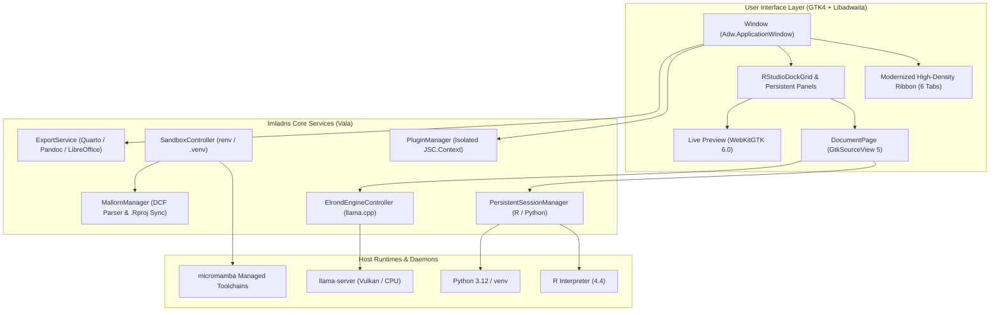

# Architecture and GNOME HIG Design Guide

Imladris is architected as a native GNOME desktop application written in **Vala** on top of **GTK4**, **Libadwaita 1.5+**, **GtkSourceView 5**, and **WebKitGTK 6.0**. It intentionally avoids heavy web app wrappers (like Electron) to achieve instant startup, native responsiveness, and tight desktop integration.

---

## 1. High-Level Subsystem Architecture

---

## 2. Core Architectural Pillars

### A. Non-Blocking Responsive UI
- Computation and disk I/O are kept strictly off the main GTK4 thread.
- Asynchronous tasks use Vala's `async`/`yield` coroutine syntax powered by GLib's `GTask` and event loop.
- Subprocesses are spawned using `GLib.Subprocess` with streamed non-blocking pipe reading for `stdout` and `stderr`.

### B. High-Density Libadwaita Ribbon Deck
- Ribbon height is optimized to ~52px using linked controls (`.linked`), native Libadwaita CSS variables (`@headerbar_bg_color`, `@window_bg_color`), and compact button layouts.
- Can be collapsed with `Ctrl+F1` for maximum editor focus.
- Context-Aware State Machine dynamically hides or reveals tabs and tools based on whether the active file is a markdown note (`.md`), HTML document (`.html`), Quarto report (`.qmd`), or polyglot notebook (`.ipynb`).

### C. Persistent REPL Sessions (`ReplBridge`)
- Unlike batch script execution, statistical analysis requires long-lived sessions so variables and models remain resident in memory between chunk runs.
- `ReplBridge` communicates over standard input/output pipes with project root synchronization (`setwd` / `os.chdir`).

### D. Zero-Overhead Plugin Engine (`javascriptcoregtk-6.0`)
- Avoids bundling NodeJS or Chrome V8.
- Uses WebKit's native JavaScriptCore C API exposed through Vala's `JSC.Context`.
- Each enabled plugin runs inside its own isolated context with a permission-guarded declarative host bridge.

---

## 3. GNOME Human Interface Guidelines (HIG) Adherence

Imladris strictly complies with GNOME design standards:
- **Design Tokens**: Standard Libadwaita named colors (`@accent_color`, `@destructive_color`, `@success_color`).
- **Accent Color Selection**: Synchronizes with GNOME 47/48/49/50 accent color preferences (Blue, Teal, Green, Yellow, Orange, Red, Pink, Purple, Slate).
- **Theming**: Flawless switching between System Theme, Light, Dark, and Eye-Friendly (warm sepia) palettes.
- **Adaptive Dialogs**: Uses `Adw.PreferencesDialog`, `Adw.PreferencesPage`, `Adw.PreferencesGroup`, and `Adw.ActionRow` for all settings.
- **Iconography**: Standardized on Papirus symbolic icons (`*-symbolic`), guaranteeing legible rendering across all accent colors and background shades.
