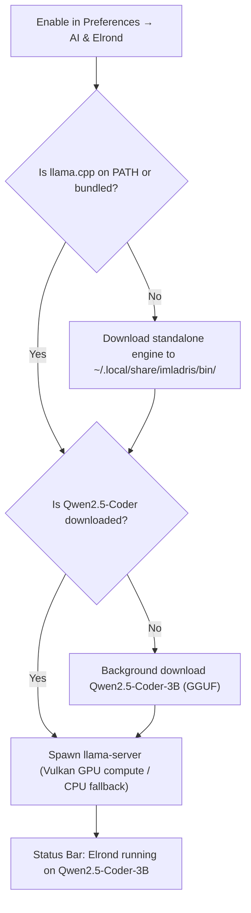

# "Write with Elrond Assistance (AI)" — Local Copilot

**Elrond Assistance (AI)** is Imladris's built-in, privacy-preserving AI coding and data science copilot. Tailored specifically for **R (tidyverse, ggplot2), Python (pandas, numpy, polars, matplotlib), SQL, and Quarto scientific authoring**, Elrond executes locally on your hardware with zero telemetry sent to third-party clouds.

---

## 1. Zero-Config "Click-and-Run" Architecture

Unlike typical developer tools that require configuring Python virtual environments, CUDA drivers, API keys, or reverse proxies, Elrond is designed for zero setup:

1. Toggle **"Write with Elrond Assistance (AI)"** on in **Preferences → AI & Elrond**.
2. If `llama.cpp` (`llama-server`) is not installed, Imladris either uses the Flatpak-bundled engine or downloads a standalone binary into `~/.local/share/imladris/bin/`.
3. If no GGUF model is selected, Imladris automatically bootstraps `Qwen2.5-Coder-3B` in the background with a progress bar.
4. The engine spawns with Vulkan GPU acceleration (falling back to multi-core CPU compute on older systems) and confirms readiness via HTTP `/health` polling.

---

## 2. Assistance Levels Comparison

In **Preferences → AI & Elrond**, an intuitive 3-stop slider lets you balance hardware usage and copilot proactivity:

| Feature / Metric | Low (On-Demand Only) | Medium (Smart Autocomplete) | High (Full Data Science Copilot) |
| :--- | :--- | :--- | :--- |
| **Trigger Mechanism** | Explicit shortcut (`Ctrl+Shift+E`) or Ribbon button click | Automatic inline completion as you pause typing | Proactive inline code suggestions + Assistant panel advice |
| **Context Window Size** | `2048` tokens (minimal RAM footprint) | `4096` tokens | `8192` tokens (full document + schema context) |
| **Typing Debounce** | N/A (on-demand) | 500 ms pause | 250 ms fast response |
| **Dataframe Awareness** | Only explicitly highlighted text | Active dataframe columns (`names(df)`, `df.columns`) | Full dataframe structure, data types, and head preview |
| **Plot Synthesis** | Only when explicitly prompted | Autocompletes standard ggplot2 / matplotlib syntax | Proactively suggests optimal chart types based on data types |
| **Recommended Hardware** | 4 GB+ RAM / Intel HD Graphics or CPU | 8 GB+ RAM / 2 GB VRAM | 16 GB+ RAM / 4 GB+ Dedicated GPU (Vulkan/CUDA) |

---

## 3. Real-Time Status Bar Telemetry Monitor

Positioned directly next to the word and line counter in the bottom status bar, Imladris polls engine memory consumption every 2 seconds without blocking the main GTK4 UI thread:

> `Elrond running on Qwen2.5-Coder-3B - 0.24 GB RAM / 2.08 GB VRAM used`

- Displays the currently loaded GGUF model name.
- Shows live host system RAM allocated by the inference subprocess.
- Shows live dedicated GPU VRAM consumption tracked via Vulkan/CUDA driver telemetry.

---

## 4. Triggering Elrond in the Editor

1. **Inline Prompt Popover (`Ctrl+Shift+E`)**: Press `Ctrl+Shift+E` or right-click in the editor and choose **"Write with Elrond Assistance (AI)"**. Type an instruction (e.g., *"Filter rows where p_value < 0.05 and plot volcano curve"*), and Elrond writes the code directly into the buffer.
2. **Inline Autocompletion**: As you type code chunks, Elrond suggests completions in ghost text or popup completion lists via `GtkSourceView`. Press `Tab` or `Enter` to accept.
3. **Dedicated Side Panel**: Open the **Assistant** side panel (`Ctrl+Alt+A`) for conversational querying, hypothesis validation, or debugging statistical models.

---

## 5. Connecting External Local & Cloud Providers

In addition to the zero-config internal engine, **Preferences → AI & Elrond** allows routing queries to:
- **Local Servers**: Ollama (`http://localhost:11434`), LM Studio (`http://localhost:1234`), Cherry Studio, or LocalAI.
- **Local CLI Harness**: Automatic discovery and integration with host Antigravity CLI (`agy`), OpenCode, or OpenClaude.
- **Frontier Cloud APIs**: Direct API key connections for Google Gemini (`gemini-2.0-flash`, `gemini-1.5-pro`), Anthropic Claude (`claude-3-5-sonnet`), DeepSeek (`deepseek-reasoner` / R1), Qwen, OpenAI, Kimi, and NVIDIA NIM.
