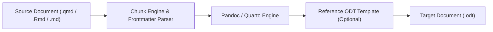

# Exporting to ODT, ODP, PDF, and HTML

Imladris includes a multi-format export pipeline accessible via the **Publish** ribbon menu or the primary application menu, designed to turn scientific notebooks and reports into publication-grade documents and presentations.

---

## 1. Supported Document Export Matrix

| Source Format | Output Target | Rendering Engine | Key Use Cases |
| :--- | :--- | :--- | :--- |
| `.qmd`, `.Rmd`, `.ipynb`, `.md` | **HTML (`.html`)** | Quarto / RMarkdown / Pandoc / WebKitGTK | Interactive online sharing, WebKit live preview |
| `.qmd`, `.Rmd`, `.ipynb`, `.md` | **PDF (`.pdf`)** | Typst / XeLaTeX / WeasyPrint / Chrome Headless | Formal manuscripts, journal submissions |
| `.qmd`, `.Rmd`, `.ipynb`, `.md` | **OpenDocument Text (`.odt`)** | Pandoc / Quarto / LibreOffice Writer | Collaborative editing in LibreOffice or Word |
| `.qmd`, `.Rmd`, `.ipynb`, `.md` | **OpenDocument Presentation (`.odp`)** | Headless LibreOffice (`soffice --convert-to odp`) | Academic slide decks, conference talks |

---

## 2. OpenDocument Text (`.odt`) Export Pipeline

Exporting to OpenDocument Text allows non-technical co-authors to review and annotate reports in LibreOffice Writer or Microsoft Word while preserving statistical tables and formulas.



### Steps to Export:
1. Open the document in Imladris.
2. Select **Publish → ODT** in the ribbon or choose **File → Export OpenDocument Text (.odt)** (`app.export_odt`).
3. Imladris evaluates executed code chunks, renders tables (`gt`, `kableExtra`, pandas DataFrames), embeds high-DPI plot images, and invokes `pandoc -f markdown -t odt -o <filename>.odt`.
4. If a custom reference document is configured in frontmatter (`reference-doc: template.odt`), Imladris respects custom paragraph and heading styles.

---

## 3. OpenDocument Presentation (`.odp`) Export Pipeline

Imladris allows data scientists to write slides in Markdown and export directly to native LibreOffice Impress (`.odp`) presentations.

### How the Headless Pipeline Works:
1. Imladris identifies slide break demarcations (`---` or `## Heading` slide splits).
2. It compiles an intermediate slide deck (or `.docx`/`.html` presentation).
3. It invokes headless LibreOffice in the background:
   ```bash
   soffice --headless --convert-to odp --outdir "/project/exports" intermediate.docx
   ```
4. Vector diagrams, ggplot2 figures, and code listings are formatted into editable Impress slide objects.

---

## 4. PDF and HTML Publishing

### HTML Publishing
Clicking **Publish → HTML** (`app.export_html`) renders the active document into a responsive HTML5 standalone bundle with embedded data URIs for images, math rendered via KaTeX/MathJax, and syntax-highlighted code blocks. You can view the output immediately via **Publish → Live Preview**.

### PDF Publishing
Clicking **Publish → PDF** (`app.export_pdf`):
- For **Quarto (`.qmd`)**: Uses **Typst** (`pdf-engine: typst`) by default for sub-second PDF compilation without requiring heavy 4GB TeXLive installations.
- For **R Markdown (`.Rmd`)**: Uses `tinytex` or host `xelatex`/`pdflatex`.
- For **Plain Markdown (`.md`)**: Uses WebKitGTK's native print-to-PDF pipeline with custom CSS margins and pagination headers.
