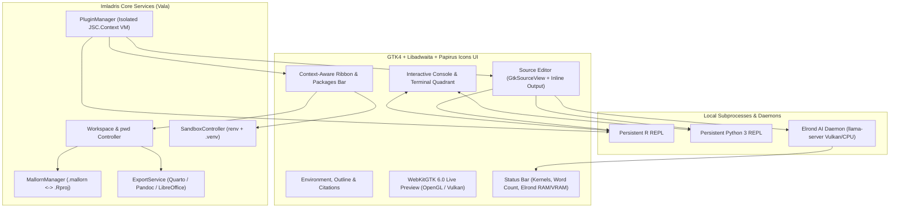

# Welcome to the Imladris IDE Wiki

**Imladris** is a native Linux scientific authoring, data science, and polyglot notebook IDE built with **Vala**, **GTK4**, **Libadwaita**, and **WebKitGTK 6.0**. Designed for researchers, bioinformaticians, statisticians, and data scientists, Imladris combines the reproducibility of RStudio and Jupyter with a modern GNOME HIG-compliant interface, 100% local Vulkan-accelerated AI assistance (**Elrond**), and an Obsidian-style JavaScript extension ecosystem (`JSC.Context`).

> [!TIP]
> **New to Imladris?** Start with the [[Installation and Building|Installation-and-Building]] guide or jump straight into [[Projects and Sandboxing|Projects-and-Sandboxing]] to learn how `.mallorn` workspaces keep your R and Python environments 100% reproducible.

---

## Core Feature Matrix

| Pillar | Feature | Description |
| :--- | :--- | :--- |
| **Workspaces & Portability** | **Standard & Sandboxed Projects** | Create multi-file `.Rmd`, `.Qmd`, or `.ipynb` projects bound either to host system libraries or isolated inside `renv` (R) and `.venv` (Python) sandboxes. |
| **1:1 RStudio Exchange** | **`.mallorn` Format** | Native project marker and portable archive format with byte-for-byte 1:1 `.Rproj` compatibility and automatic `renv.lock` / `requirements.txt` snapshotting. |
| **Fast-Path Editors** | **9 Creation Targets** | Launch full computational notebooks or lightweight single-file editors for `.md`, `.html`, `.R`, and `.py` with hardware-accelerated WebKitGTK 6.0 live preview. |
| **Interactive Compute** | **Live REPL & Inline Output** | Persistent bidirectional `R` and `Python 3` consoles with inline chunk stdout, dataframe previews, and high-DPI plot capture. |
| **Package Management** | **Packages Ribbon Bar** | Dedicated top Ribbon tab featuring live CRAN and PyPI search autocomplete, `uv`/`pak` acceleration, plus `...` overflow menus for GitHub (`owner/repo`) and local archive (`.tar.gz`, `.whl`) installations. |
| **Local AI Copilot** | **Write with Elrond Assistance (AI)** | Zero-configuration local AI powered by `llama.cpp` (Vulkan GPU / CPU fallback) and `Qwen2.5-Coder-3B`, featuring `Low`, `Medium`, and `High` assistance levels and live RAM/VRAM status bar telemetry. |
| **Scientific Publishing** | **ODT, ODP, PDF & HTML** | Native export pipelines via Quarto, RMarkdown, Pandoc, and headless LibreOffice for OpenDocument Text (`.odt`) and Presentations (`.odp`). |
| **Community Plugins** | **`.implugin` Extensions** | Obsidian-style third-party plugins written in JavaScript (`JSC.Context`) using declarative Libadwaita UI builders and **Papirus** symbolic icons. |

---

## System Architecture Overview

---

## Quick Navigation

### 1. Getting Started
* [[Installation and Building|Installation-and-Building]] — Flatpak setup, Meson/Ninja compilation, and OpenGL/Vulkan hardware acceleration settings.
* [[Projects and Sandboxing|Projects-and-Sandboxing]] — Understanding Standard vs. Sandboxed projects and automatic `pwd` root locking.
* [[Mallorn Format and RStudio|Mallorn-Format-and-RStudio]] — Sharing `.mallorn` bundles and 1:1 interoperability with RStudio and Jupyter.

### 2. Daily Workflows
* [[Packages Ribbon Manager|Packages-Ribbon-Manager]] — Installing R (CRAN) and Python (PyPI) packages, GitHub repos, and local archives directly from the Ribbon.
* [[Exporting ODT, ODP, PDF and HTML|Exporting-ODT-ODP-PDF]] — Rendering documents and slide decks to OpenDocument and publication formats.

### 3. Elrond Assistance (AI) & Extensions
* [[Elrond Local AI Copilot|Elrond-Local-AI-Copilot]] — Zero-config setup, `Low`/`Medium`/`High` assistance modes, dataframe schema awareness, and RAM/VRAM monitoring.
* [[Plugin Development Guide|Plugin-Development-Guide]] — Build your first `.implugin` extension in 5 minutes using JavaScript.
* [[Plugin API Reference|Plugin-API-Reference]] — Complete documentation for the `imladris.*` JavaScriptCore bridge.
* [[Architecture and HIG|Architecture-and-HIG]] — Technical design notes and GNOME Human Interface Guidelines compliance.
* [[License and GPLv3|License-and-GPLv3]] — GNU GPLv3 terms and the Script Interface Exception for third-party plugin authors.
