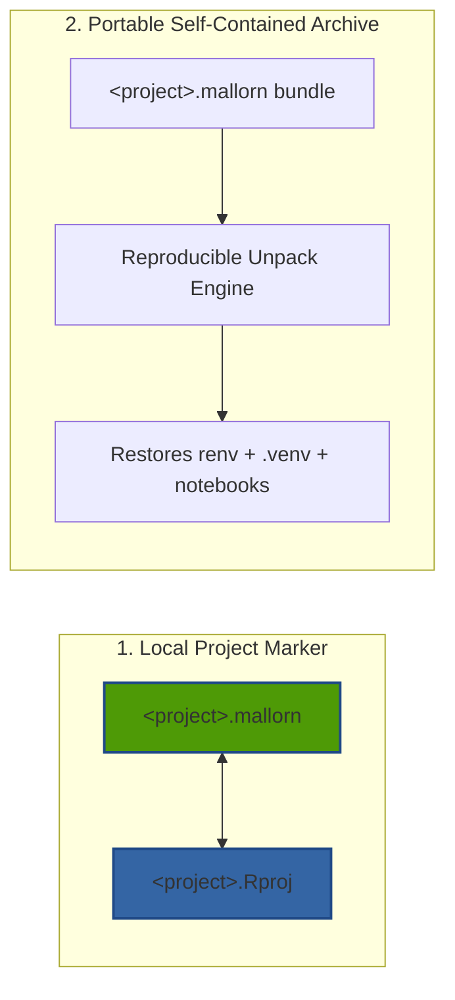

# The `.mallorn` Format & 1:1 RStudio Synchronization

Imladris introduces the **`.mallorn`** specification to solve a fundamental problem in scientific publishing: creating a project format that feels native to modern Linux and GNOME while preserving **100% byte-for-byte interoperability with RStudio and Jupyter**.

---

## 1. Dual Nature of the `.mallorn` Format

The `.mallorn` specification operates in two distinct modes:



### Mode 1: Local Project Marker (`<name>.mallorn` & `<name>.Rproj`)
Inside any Imladris workspace folder, Imladris writes a `<name>.mallorn` file using RStudio's **Debian Control File (DCF)** key-value syntax. 

Imladris simultaneously generates and maintains a twin `<name>.Rproj` file:
- Whenever you open an existing RStudio project in Imladris, it automatically parses `<name>.Rproj`.
- Whenever you modify project settings, Imladris writes both files in sync.
- A collaborator using RStudio on Windows, macOS, or Linux can double-click `<name>.Rproj` and immediately work on the same repository without conflicts.

#### Sample `.mallorn` File Specification
```dcf
Version: 1.0
RestoreWorkspace: No
SaveWorkspace: No
AlwaysSaveHistory: Default

EnableCodeIndexing: Yes
UseSpacesForTab: Yes
NumSpacesForTab: 2
Encoding: UTF-8

RnwWeave: knitr
LaTeX: pdfLaTeX

ImladrisVersion: 0.13.0
ImladrisProjectType: Sandboxed
ImladrisTarget: Quarto
ImladrisPythonEnv: .venv
ImladrisRenvActive: Yes
```

All keys prefixed with `Imladris*` are ignored by standard RStudio while providing project metadata to Imladris.

---

## 2. Mode 2: The Portable `.mallorn` Exchange Archive

When sharing code with peer reviewers or colleagues, standard `.zip` files often fail because huge local folders (`renv/library/`, `.venv/`, `.git/`, `.cache/`) are either accidentally included (bloating the archive to gigabytes) or critical lockfiles are missed.

### Exporting a `.mallorn` Archive
In the Ribbon under **Publish → .mallorn**:
1. Imladris gathers all notebooks (`.qmd`, `.Rmd`, `.ipynb`), scripts (`.R`, `.py`), configuration files, and datasets.
2. It captures the exact dependency state in `renv.lock` and `requirements.txt`.
3. It strips non-portable binaries, `.venv/bin/`, and local object caches.
4. It packages the workspace into a compressed `.mallorn` tarball (using `tar.zst` with high-ratio Zstandard compression, falling back to standard `.zip` if zstd is unavailable).

### Unpacking and Restoring a `.mallorn` Project
When a colleague receives a `<project>.mallorn` file:
1. They double-click the file or select **File → Open Document or Project…** in Imladris.
2. Imladris unpacks the repository structure into their chosen destination.
3. If dependencies need restoration, clicking **Restore Environment** runs `renv::restore()` and `python3 -m venv .venv && uv pip install -r requirements.txt`.
4. The environment is restored to the exact package versions used by the original author.

---

## 3. Dedicated RStudio and Jupyter Exporting

In addition to `.mallorn` bundles, the **Publish** ribbon includes direct export bridges:
- **Export for RStudio**: Generates a clean RStudio project bundle with `.Rproj`, `renv/activate.R`, `.Rprofile`, and a standardized `run_all.R` harness.
- **Export for Jupyter Notebook**: Exports workspace notebooks along with `environment.yml`, `requirements.txt`, and an automated virtual environment bootstrap script.
