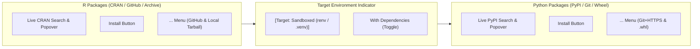

# Packages Ribbon Manager

Imladris features a dedicated **Packages** Ribbon Tab in the top window menu (`Ctrl+Shift+P` or clicking **Packages** in the ribbon switcher) that replaces modal package manager dialogs with an integrated, high-density toolbar.

---

## 1. Overview of the Packages Ribbon Bar

### Context-Aware State Machine
The **Packages** tab is dynamically shown when working on computational projects (`.Rmd`, `.Qmd`, `.ipynb`, `.R`, `.py`) and automatically concealed when editing plain Markdown (`.md`) or HTML (`.html`).

---

## 2. Managing R Packages

### Installing from CRAN
1. Click the **CRAN package name** search field in the R section.
2. Start typing (e.g., `ggp...`). An autocomplete popover lists matching CRAN packages with description blurbs.
3. Select the package with `Up`/`Down` arrow keys or mouse click, and press `Enter` (or click **Install**).
4. Imladris checks if **`pak`** is available. If present, it executes via `pak::pkg_install()`, providing up to 10x faster concurrent downloads and binary resolution. Otherwise, it uses standard `install.packages()`.

### Installing from GitHub (`owner/repo`)
Click the `...` overflow button next to the R install button and select **Install from GitHub**:
- Enter the repository slug (e.g., `tidyverse/ggplot2` or `r-lib/devtools`).
- Imladris runs `remotes::install_github("owner/repo")` or `pak::pkg_install("owner/repo")`.

### Installing Local Source Archives (`.tar.gz`, `.zip`)
Select **Install Local Package Archive…** in the `...` overflow menu to open a file picker and select a downloaded source package.

---

## 3. Managing Python Packages

### Installing from PyPI
1. Click the **PyPI package name** search field in the Python section.
2. Type the package query (e.g., `polars`, `scikit-learn`, `matplotlib`).
3. Press `Enter` or click **Install**.
4. Imladris checks for **`uv`** on `$PATH` or inside the project prefix. If detected, it executes `uv pip install <package>`, resolving wheels in milliseconds. Otherwise, it falls back to `python -m pip install <package>`.

### Installing from Git (`git+https://...`)
Click the `...` overflow button in the Python section and select **Install from Git Repository**:
- Input a repository URL (e.g., `git+https://github.com/psf/requests.git`).

### Installing Local Wheels or Archives (`.whl`, `.tar.gz`)
Select **Install Local Wheel (.whl / .tar.gz)…** to install offline wheel distributions.

---

## 4. ETag Disk Caching & $O(\log N)$ Binary Search

To keep search autocomplete instantaneous:
- Imladris maintains cached sorted indices of available packages in `~/.cache/imladris/indices/`.
- Indices are queried with HTTP `ETag` headers; if no upstream updates exist on CRAN/PyPI, zero network bandwidth is consumed.
- Autocomplete lookups use in-memory binary search prefix matching, completing in under 0.1ms without UI stutter.

---

## 5. Automatic Lockfile Synchronization

When working inside a **Sandboxed Project**:
- After any successful R installation, Imladris updates **`renv.lock`**.
- After any successful Python installation, Imladris updates **`requirements.txt`**.
- All dependencies remain hermetic to the project directory, protecting your host environment.
