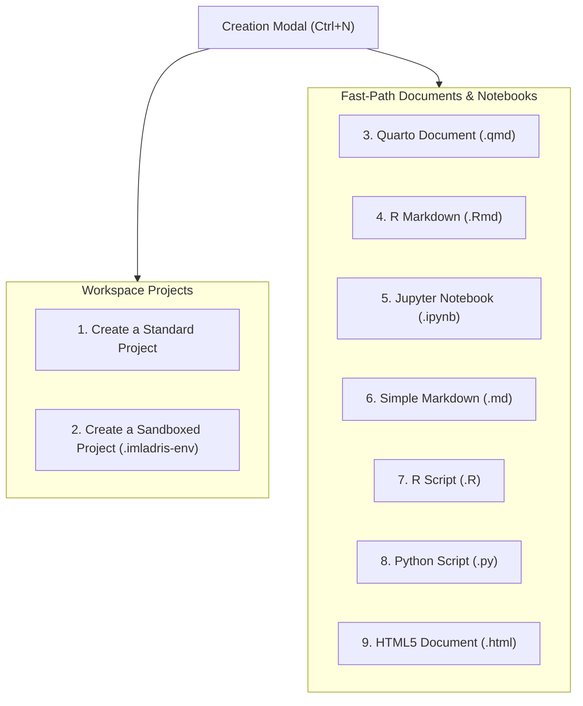

# Projects and Sandboxing Architecture

Imladris distinguishes between **single-document rapid drafting** and **multi-file computational research projects**, giving users maximum speed for prose and rigorous hermetic isolation for data science.

---

## 1. The 9 Creation Targets

Clicking **"New Project or Document…"** (`Ctrl+N` or top-left Imladris brand menu) opens the Creation Modal with 9 specialized targets:

### Document Targets vs. Workspace Projects
- **Single-File Fast-Path (`.md`, `.html`)**: Apostrophe-style distraction-free writer mode. No background R or Python interpreters are spawned, keeping memory usage minimal.
- **Standalone Notebooks (`.qmd`, `.Rmd`, `.ipynb`)**: Launches the 4-quadrant RStudio workbench mode with active editor, environment inspector, console, and files pane.
- **Multi-File Workspace Projects**: Creates a dedicated project directory with scaffolded README, data folder, script directory, and either a standard or sandboxed environment marker.

---

## 2. Standard vs. Sandboxed Projects

| Characteristic | Standard Project | Sandboxed Project (`.imladris-env`) |
| :--- | :--- | :--- |
| **R Packages** | Global user library (`~/R/x86_64-pc-linux-gnu-library/`) | Project-local `renv` library (`renv/library/`) |
| **Python Packages** | System or user site-packages (`~/.local/lib/python3.X/`) | Project-local virtual environment (`.venv/`) |
| **Portability Guarantee** | ⚠️ Non-portable (relies on host packages) | 🛡️ 100% Reproducible across machines |
| **Status Badge** | `[System Libraries - Non-Portable]` (Amber) | `[Sandboxed - Reproducible]` (Green) |
| **Lockfiles** | None (unless manually initialized) | Automatic `renv.lock` and `requirements.txt` |
| **Export Confirmation** | Prompts confirmation alert on export | One-click export to RStudio or Jupyter |

### How Sandboxing Works Under the Hood
When a **Sandboxed Project** is created or opened:
1. **R Sandboxing (`renv`)**:
   - `SandboxController` generates a `.Rprofile` inside the project root that automatically bootstraps `renv`.
   - Packages installed via the Packages Ribbon Bar or `install.packages()` are isolated inside `renv/library/`.
   - On document save or package installation, `renv.lock` is automatically synchronized.
2. **Python Sandboxing (`.venv`)**:
   - `SandboxController` runs `python3 -m venv .venv` inside the project root.
   - All interactive commands dispatched via the REPL or code chunks use `.venv/bin/python`.
   - Package installations via `uv` or `pip` are pinned in `requirements.txt`.

> [!WARNING]
> Exporting a **Standard Project** triggers a confirmation modal warning that external machines might lack required packages. To ensure your scientific findings are reproducible by peer reviewers, always use **Sandboxed Projects**.

---

## 3. Automatic `pwd` (Working Directory) Root Locking

In statistical computing, broken file paths (`data/samples.csv not found`) are a common pain point when running chunks from subfolders.

Imladris enforces **strict project-root locking** across all subsystems:
- **Files Pane**: Always displays the project root tree.
- **R Subprocess**: Dispatches `setwd("/path/to/project_root")` upon session connection.
- **Python Subprocess**: Dispatches `os.chdir("/path/to/project_root")` upon session connection.
- **Subprocess Spawner**: Every shell command or script runner executes with `launcher.set_cwd(project_root)`.

Relative paths like `read.csv("data/experiment.csv")` or `pd.read_parquet("data/features.parquet")` consistently resolve to the project root across all chunks and console sessions.
